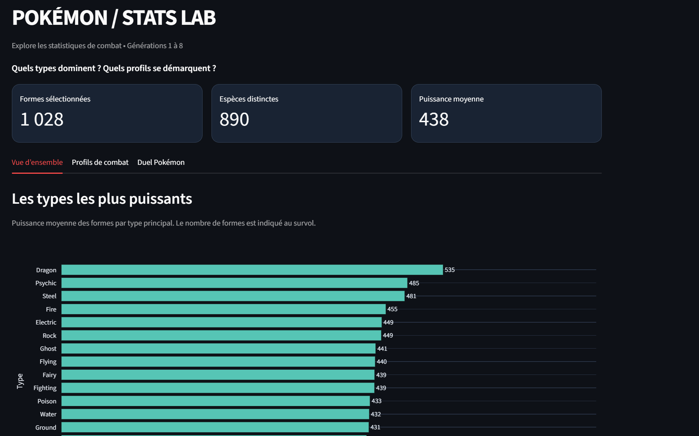
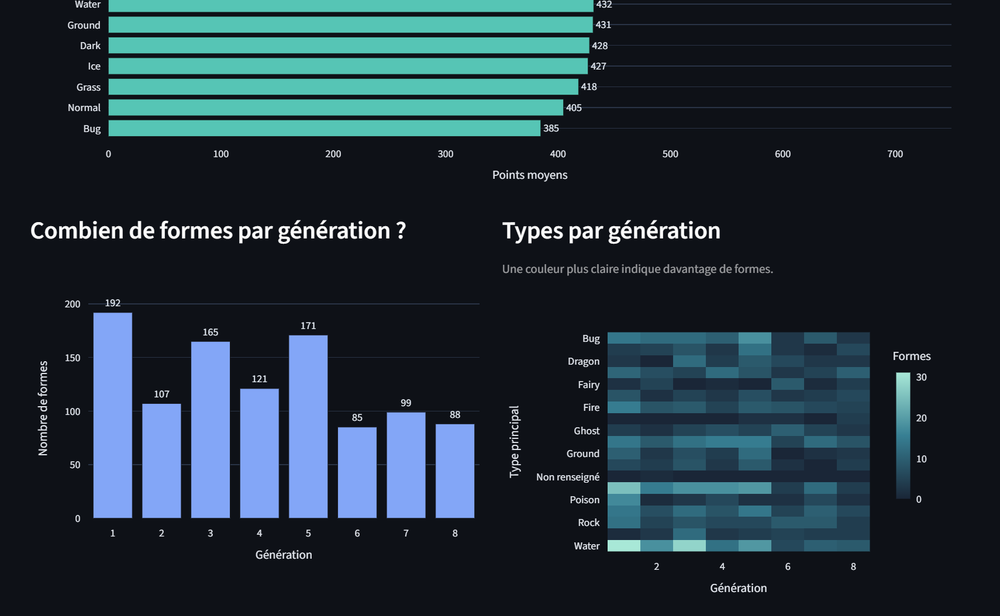
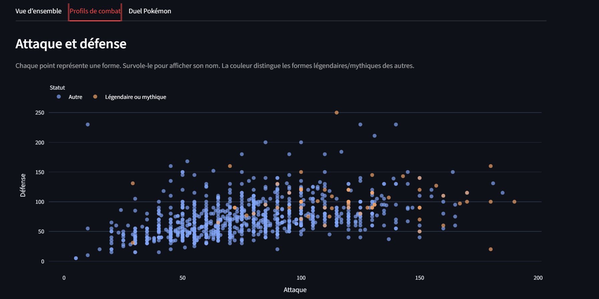
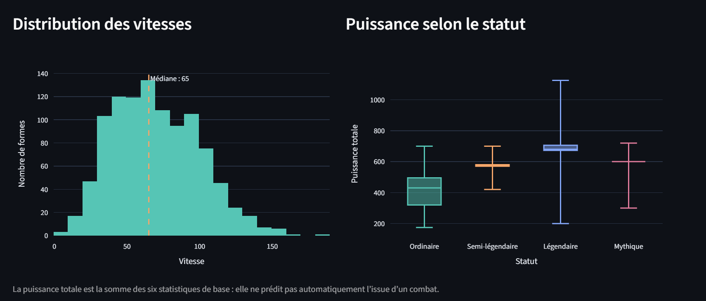
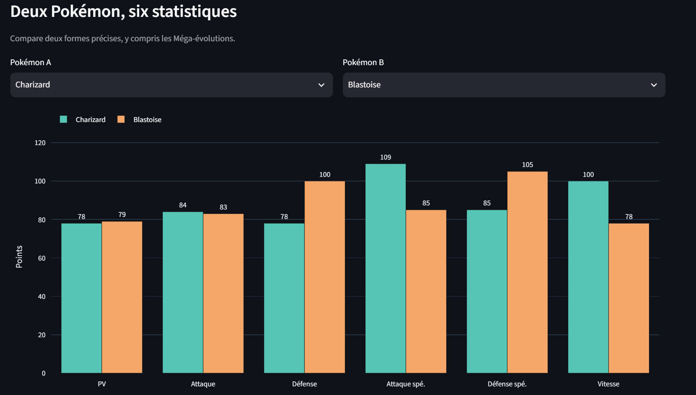
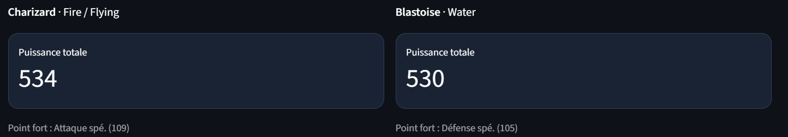

# Atlas Pokémon — DataViz

Projet individuel sur les jeux vidéo. J'ai choisi d'explorer les statistiques des Pokémon : les types, les générations et les profils de combat.

**Problématique :** Quels profils de Pokémon se distinguent selon les types et les générations ?

L'application permet de filtrer les générations, les types et les statuts, de comparer les moyennes et les distributions, puis de confronter deux Pokémon dans un face-à-face.

## Lancement

Installer les dépendances avec `pip install -r requirements.txt`, puis lancer `streamlit run app.py`.

Les différentes formes d'un Pokémon sont conservées : une ligne représente une forme et non forcément une espèce unique. Les statistiques manquantes ne sont pas inventées.

Outils : Python, pandas, Plotly, Streamlit. 
Données : `pokedex.csv`.

## Aperçu du dashboard

### Vue d'ensemble

### Analyse des combats

### Comparateur Pokémon

