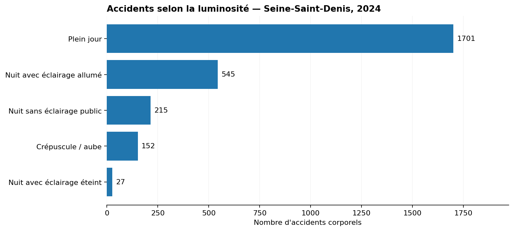

# Accidents corporels en Seine-Saint-Denis (2024)

**Projet de DataViz — analyse des accidents corporels de la circulation dans le département 93.**

## Objectif et données

**Question :** Où les accidents corporels se concentrent-ils en Seine-Saint-Denis et dans quelles conditions de luminosité surviennent-ils ?

Source : [Base officielle des accidents corporels de la circulation (data.gouv.fr)](https://www.data.gouv.fr/datasets/bases-de-donnees-annuelles-des-accidents-corporels-de-la-circulation-routiere-annees-de-2005-a-2025), fichier `caract-2024.csv`.

J'ai filtré les accidents de **2024** pour le **département 93**, converti les coordonnées GPS en nombres et écarté les coordonnées manquantes ou manifestement hors de la zone étudiée. Le jeu de données final contient **2640 accidents**, avec une ligne par accident. Les accidents sans blessé ne figurent pas dans cette base. La carte ne permet pas, à elle seule, de mesurer le risque routier : elle ne tient pas compte du trafic ni du nombre d'habitants.

## Partie 1 — Lisibilité : règles 7 à 16

Référence : [GoldenViz — Lisibilité](https://goldenviz.org/fr/readability.html).

| Règle | Problème illustré | Correction | Application à mon projet |
|---|---|---|---|
| **7. Étiquettes et graduations lisibles** | Trop de graduations, petits caractères ou textes inclinés | Simplifier les axes et agrandir les étiquettes | Libellés complets et horizontaux sur les barres |
| **8. Accessibilité des couleurs** | Couleurs trop proches et difficiles à différencier | Palette contrastée et limitée | Une couleur principale ; les valeurs sont également écrites |
| **9. Étiquetage direct** | Allers-retours entre légende et données | Mettre les étiquettes près des éléments | Effectifs affichés à côté des barres |
| **10. Éviter le chartjunk** | 3D, bordures et décorations superflues | Retirer les effets qui n'aident pas à comprendre | Aucun effet 3D ; quadrillage discret |
| **11. Trop de catégories** | Trop de catégories rendent la comparaison difficile | Filtrer ou regrouper | Une seule année, un seul département, cinq modalités de luminosité |
| **12. Trier les barres catégorielles** | Catégories sans ordre clair | Trier les barres par valeur | Barres classées par nombre d'accidents |
| **13. Surimpression** | Les points superposés masquent les concentrations | Transparence, agrégation ou regroupement | Points semi-transparents sur la carte interactive |
| **14. Précision décimale** | Chiffres trop précis, lecture ralentie | Arrondir selon le besoin | Effectifs entiers ; coordonnées détaillées uniquement dans les données |
| **15. Formatage des dates** | Dates longues ou trop rapprochées | Réduire les graduations, raccourcir les dates | Date courte dans les fenêtres de la carte, sans axe temporel surchargé |
| **16. Économie visuelle** | Trop d'informations affichées simultanément | Ne conserver que les éléments utiles | Une carte et un graphique principal, sans surcharge |

## Partie 2 — Visualisations

### 1. Répartition géographique

**[Ouvrir la carte interactive](carte_accidents_93.html)** (télécharger le fichier HTML si GitHub ne l'affiche pas directement).

La carte HTML est **autonome et consultable hors connexion** : elle utilise des coordonnées GPS (longitude et latitude) avec un contour administratif simplifié intégré au fichier. Elle permet de zoomer, de survoler les accidents pour afficher leur date, leur heure et leur luminosité, et de masquer certaines catégories dans la légende. Les points sont semi-transparents pour limiter la surimpression. Le contour départemental est **simplifié** à partir de points du GeoJSON IGN et les noms de villes sont des **repères approximatifs** (non utilisés pour calculer les résultats). Aucun fond de rues n’est nécessaire. Source du contour : [France GeoJSON — Seine-Saint-Denis](https://github.com/gregoiredavid/france-geojson/blob/master/departements/93-seine-saint-denis/departement-93-seine-saint-denis.geojson) (IGN, édition 2018).

### 2. Conditions de luminosité

| Conditions de luminosité | Accidents | Part |
|---|---:|---:|
| Plein jour | 1 701 | 64.4 % |
| Nuit avec éclairage allumé | 545 | 20.6 % |
| Nuit sans éclairage public | 215 | 8.1 % |
| Crépuscule / aube | 152 | 5.8 % |
| Nuit avec éclairage éteint | 27 | 1.0 % |

### Interprétation

La majorité des accidents enregistrés surviennent **en plein jour**. Parmi les accidents de nuit, ceux avec éclairage public allumé sont les plus nombreux. Cela ne signifie pas que le plein jour ou l'éclairage allumé provoquent davantage d'accidents : il faudrait connaître le trafic, la durée d'exposition et les lieux pour comparer les risques.

La carte montre les localisations enregistrées ; les zones avec beaucoup de points peuvent correspondre à des axes plus fréquentés. Il faut éviter d'interpréter directement le nombre de points comme un taux de dangerosité.

### Choix graphiques et règles appliquées

- **7** : noms de catégories lisibles sans rotation.
- **8** : couleur unique et contraste suffisant.
- **9** : valeurs écrites directement à côté des barres.
- **10 et 16** : suppression des effets décoratifs et des informations secondaires.
- **12** : tri décroissant des catégories.
- **13** : transparence des points sur la carte interactive.

## Reproduire le travail

Installer les dépendances avec `pip install -r requirements.txt`, puis exécuter `python analyse.py` depuis ce dossier. Le script utilise aussi `contour_93.py` pour tracer le département et les repères urbains. Il lit `accidents_93_2024.csv` et régénère les images et la carte HTML.

**Limites :** la base décrit des accidents corporels enregistrés, pas l'ensemble des collisions ni le volume de circulation. L'étude est descriptive et limitée à 2024 et au département 93.
