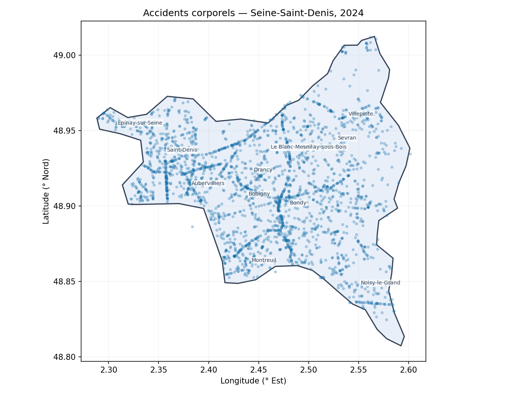

# Accidents corporels en Seine-Saint-Denis (2024)

**Projet de DataViz — Analyse des accidents corporels de la circulation en Seine-Saint-Denis.**

## Objectif et données

**Question :** Où les accidents corporels se concentrent-ils en Seine-Saint-Denis et dans quelles conditions de luminosité surviennent-ils ?

Source : [Base officielle des accidents corporels de la circulation (data.gouv.fr)](https://www.data.gouv.fr/datasets/bases-de-donnees-annuelles-des-accidents-corporels-de-la-circulation-routiere-annees-de-2005-a-2025), fichier `caract-2024.csv`.

J'ai filtré les accidents de **2024** pour le **département 93**, converti les coordonnées GPS en nombres et écarté les coordonnées manquantes ou manifestement hors de la zone étudiée. Le jeu de données final contient **2640 accidents**, avec une ligne par accident. Les accidents sans blessé ne figurent pas dans cette base. La carte ne permet pas, à elle seule, de mesurer le risque routier : elle ne tient pas compte du trafic ni du nombre d'habitants.

## Partie 1 — Lisibilité : règles 7 à 16

Référence : [GoldenViz — Lisibilité](https://goldenviz.org/fr/readability.html).

| Règle | Problème illustré | Correction | Application à mon projet |
|---|---|---|---|
| **7. Étiquettes et graduations lisibles** | Trop de graduations, petits caractères ou textes inclinés | Simplifier les axes et agrandir les étiquettes | Libellés complets et horizontaux sur les barres |
| **8. Accessibilité des couleurs** | Couleurs trop proches et difficiles à différencier | Palette contrastée et limitée | Une couleur principale ; les valeurs sont également écrites |
| **9. Étiquetage direct** | Allers-retours entre légende et données | Mettre les étiquettes près des éléments | Effectifs affichés à côté des barres |
| **10. Éviter le chartjunk** | 3D, bordures et décorations superflues | Retirer les effets qui n'aident pas à comprendre | Aucun effet 3D ; quadrillage discret |
| **11. Trop de catégories** | Trop de catégories rendent la comparaison difficile | Filtrer ou regrouper | Une seule année, un seul département, cinq modalités de luminosité |
| **12. Trier les barres catégorielles** | Catégories sans ordre clair | Trier les barres par valeur | Barres classées par nombre d'accidents |
| **13. Surimpression** | Les points superposés masquent les concentrations | Transparence, agrégation ou regroupement | Points semi-transparents sur la carte interactive |
| **14. Précision décimale** | Chiffres trop précis, lecture ralentie | Arrondir selon le besoin | Effectifs entiers ; coordonnées détaillées uniquement dans les données |
| **15. Formatage des dates** | Dates longues ou trop rapprochées | Réduire les graduations, raccourcir les dates | Date courte dans les fenêtres de la carte, sans axe temporel surchargé |
| **16. Économie visuelle** | Trop d'informations affichées simultanément | Ne conserver que les éléments utiles | Une carte et un graphique principal, sans surcharge |

## Partie 2 — Visualisations

### 1. Répartition géographique

**[Ouvrir la carte interactive](carte_accidents_93.html)**

La carte interactive représente les accidents corporels enregistrés en Seine-Saint-Denis en 2024 à partir de leurs coordonnées GPS. Elle permet de zoomer, d'obtenir des informations sur chaque accident et de filtrer les résultats selon les conditions de luminosité.

Pour faciliter la lecture, les points sont légèrement transparents afin de limiter leur superposition. Le contour du département est simplifié et les villes servent uniquement de repères géographiques.

Source du contour : [France GeoJSON — Seine-Saint-Denis](https://github.com/gregoiredavid/france-geojson/blob/master/departements/93-seine-saint-denis/departement-93-seine-saint-denis.geojson).

### 2. Conditions de luminosité

| Conditions de luminosité | Accidents | Part (%) |
|---|---:|---:|
| Plein jour | 1 701 | 64.4 % |
| Nuit avec éclairage allumé | 545 | 20.6 % |
| Nuit sans éclairage public | 215 | 8.1 % |
| Crépuscule / aube | 152 | 5.8 % |
| Nuit avec éclairage éteint | 27 | 1.0 % |

### Interprétation des résultats

En 2024, 2 640 accidents corporels ont été enregistrés en Seine-Saint-Denis. Parmi eux, 1 701 accidents (64,4 %) se sont produits en plein jour. Les accidents de nuit avec éclairage public allumé arrivent ensuite avec 545 cas (20,6 %).

Cependant, cela ne signifie pas que conduire de jour est plus dangereux. Il faudrait connaître le volume de circulation selon les horaires pour pouvoir comparer les risques.

La carte permet de visualiser la répartition géographique des accidents dans le département. On remarque que certains secteurs concentrent davantage de points, notamment le long de plusieurs axes routiers. Ces concentrations peuvent être liées à une circulation plus importante, mais les données ne permettent pas de l'affirmer.

### Choix graphiques et règles de lisibilité appliquées

Pour rendre les visualisations plus simples à comprendre, j'ai appliqué plusieurs règles de lisibilité étudiées dans le support GoldenViz :

- **Règle 7 – Étiquettes lisibles** : j'ai utilisé des libellés de catégories horizontaux pour faciliter la lecture du graphique en barres.

- **Règle 8 – Couleurs** : j'ai choisi une couleur unique pour les barres et des couleurs distinctes pour représenter les conditions de luminosité sur la carte.

- **Règle 9 – Étiquetage direct** : j'ai affiché les valeurs directement à côté des barres pour éviter de devoir les estimer à partir de l'axe.

- **Règles 10 et 16 – Simplicité** : j'ai supprimé les éléments décoratifs inutiles afin de mettre en avant les informations importantes.

- **Règle 12 – Tri des catégories** : les conditions de luminosité sont classées par nombre décroissant d'accidents pour faciliter leur comparaison.

- **Règle 13 – Superposition des points** : j'ai utilisé des points semi-transparents sur la carte pour limiter leur superposition et mieux visualiser les concentrations d'accidents.

Ces choix permettent de rendre les deux visualisations plus claires et de faciliter la comparaison des résultats.

**Limites :** la base décrit des accidents corporels enregistrés, pas l'ensemble des collisions ni le volume de circulation. L'étude est descriptive et limitée à 2024 et au département 93.
